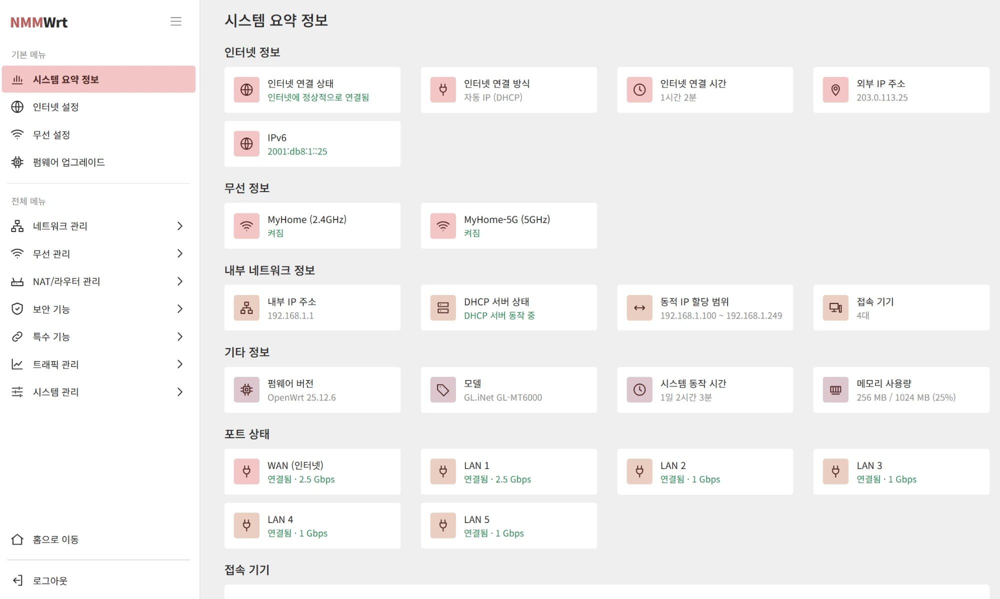

# nmmwrt
NMMWrt - An easy web interface for OpenWrt configuration.
> [!WARNING]
> ### 100% AI-Generated Project 
>
> **NMMWrt was created with AI.** Compatibility issues may occur, so please verify that your router is supported before installation.

- Supports OpenWrt 25+
- Korean only

## Screenshot

## Tested
- GL.iNet GL-MT3000 OpenWrt 25.12.6
- GL.iNet GL-MT6000 OpenWrt 25.12.6
- ipTIME AX3000Q OpenWrt 25.12.5 ~ 6
